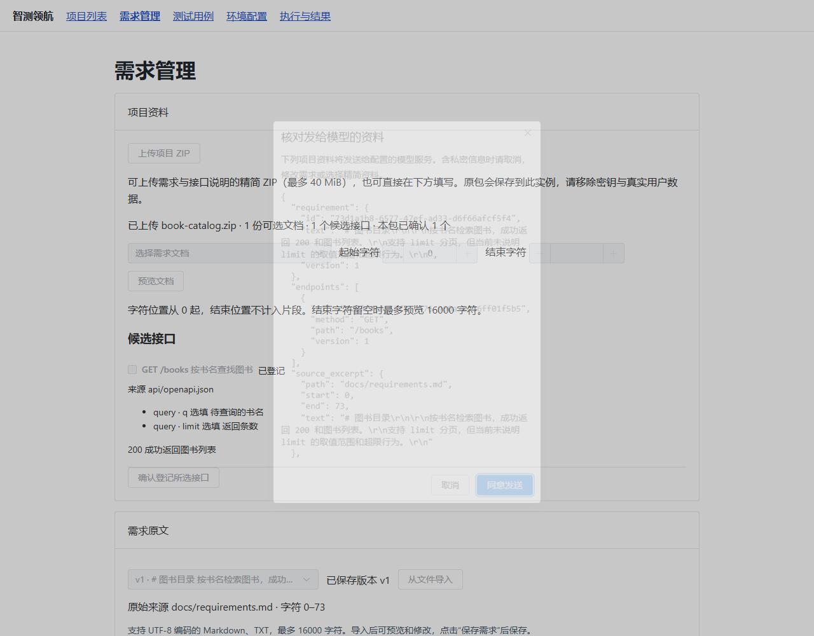
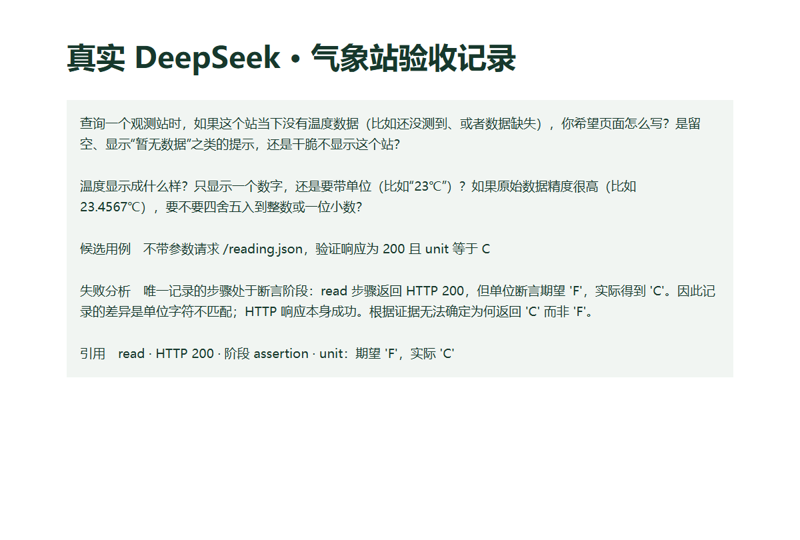
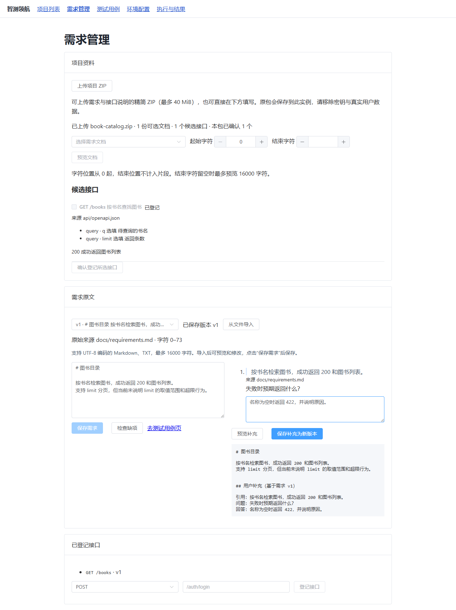
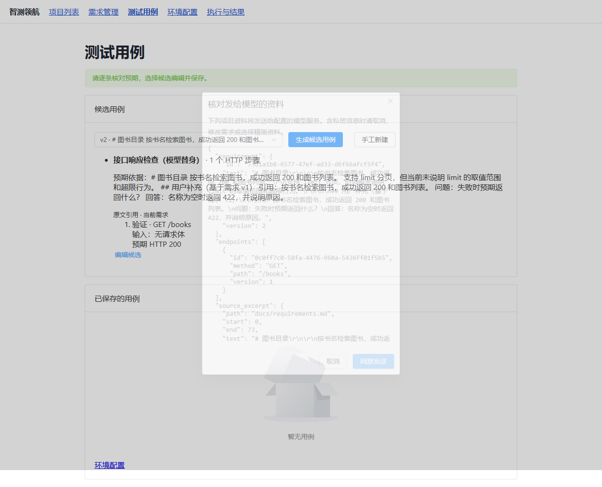
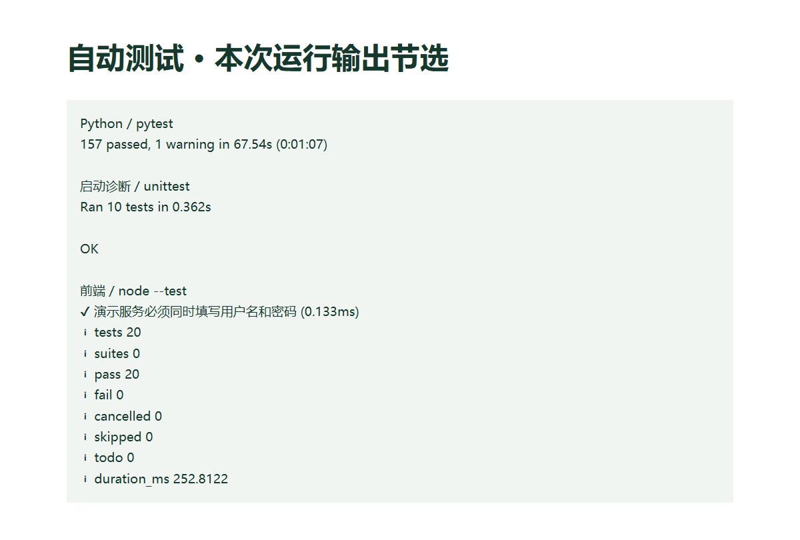

# 智测领航-beta冲刺

| 项目 | 内容 |
| --- | --- |
| 班级 | [福州大学软件工程与软件工程实践](https://edu.cnblogs.com/campus/fzu/2026-01SoftwareEngineeringandSoftwareEngineeringPractice) |
| 作业 | [Beta 冲刺与发布会](https://edu.cnblogs.com/campus/fzu/2026-01SoftwareEngineeringandSoftwareEngineeringPractice/homework/16796) |
| 项目 | 智测领航 TestPilot |
| 目标 | 让开发者导入自己的需求和接口资料，核对 AI 建议，用真实 HTTP 响应验证预期。 |
| 成员和学号 | 发布时由统稿人按课程登记表填写完整名单和学号。 |

## 一、Alpha 之后改了什么

Alpha 已经可以上传 ZIP、补充需求、确认用例、运行并下载报告。40 MiB 导入上限、批次切换和凭据校验均是开工前已有的修复。Beta 从另一个问题入手。一个针对箭头小游戏调出来的系统，换成一个从未为它写过适配器的 HTTP 服务，能判断哪些规则可测吗？

| 实际问题 | 本次修改 | 验证方式 |
| --- | --- | --- |
| 提示词直接举棋盘、碰撞、通关等业务规则，容易把其他项目的问题带偏 | 从当前需求与已登记接口构建提示。对 OpenAPI JSON 请求体提取顶层字段、类型和是否必填。次数与顺序须有实际步骤支撑 | 用图书目录做浏览器回归，再用没提供 OpenAPI 的气象站走手工登记，后者成功生成与温度有关的候选 |
| 用例标题听起来正确，用户难以判断实际查了什么 | 提示依据来自原文、相似原句或尚待核对。页面列出实际接口、输入和断言 | 打开候选即可核对一条测试的依据与动作，生成后用例库仍为空 |
| 用户担心接口和需求被发送给第三方 | 追问、候选生成和失败分析均可先预览将发送的业务资料并取消。发送时核对摘要，防止确认后资料变化 | 自动测试验证预览与实际生成输入一致，变更后使用旧摘要得到 409 |
| 常规生产构建打开旧样例页 | 生产默认使用真实同源 API，仍可显式切换样例模式 | 真实构建产物在 Edge 完成上传、追问、补充保存、再生成 |



## 二、领域 Agent 在哪里发挥作用

给气象观测站的第一版需求只有一句“查询观测站时要显示温度。”团队的验证程序导入这份 ZIP，手工登记 GET /reading.json。真实 DeepSeek 追问了没有观测值时如何显示、应使用什么单位以及显示精度。随后把本轮范围限定在正常读取，并补充请求无需登录、预期 HTTP 200、unit 为 C。模型生成一条候选，引用了补充后的原句。第一次尝试中资料过少，生成接口返回 422；补全调用方式和预期后才取得下面的结果。



人工确认是独立步骤。浏览器回归使用图书目录和固定模型回复，以便每次都能重现原文追问、保存 v2 和候选复核；下图记录的是这项界面回归。




气象站的执行目标是本机启动的 Python 标准库 HTTP 服务。验收程序另外建立两条固定对照用例，两次请求均返回 HTTP 200、unit 为 C。预期 C 的通过，故意写成 F 的失败。这个结果说明断言能发现业务差异。真实 DeepSeek 读了该失败步骤，引用了字段预期与实际，并指出仅凭响应无法断定根因。分析前后，报告字节一致。[模型返回与测试结果](evidence/beta/station.json) · [冻结的执行报告](evidence/beta/station-report.html)

## 三、关键模块如何验证

11 月 27 日在 Windows 实际运行了后端 157 项、前端 20 项、启动诊断 10 项，全部通过。后端保留一条 Starlette 测试客户端弃用警告。前端类型检查和真实模式生产构建通过。Edge 验证覆盖 32.7 MiB 合成 ZIP、超过 40 MiB 的拒绝、无 OpenAPI 时手工登记、保存失败保留原稿、v2 重新载入和生成前预览。



单测替换外部模型，稳定检查项目边界、未知端点、引用定位、版本变化及失败证据。单独的真实模型验收使用合成业务资料。测试者可在仓库根目录使用安装后端依赖的 Python 运行以下命令。

```powershell
python -m pytest -q
python -m unittest discover -s scripts/tests
npm.cmd --prefix frontend test
python scripts/verify_beta_catalog.py
# 调用真实模型时，在隐藏提示符输入密钥
python scripts/verify_beta_catalog.py --live
```

## 四、协作与成员收获

本轮由郭泽强组织验收、Codex 执行开发与自动回归。主讲与技术统筹分工沿用团队安排。曾炜毅统稿，沈冠宇负责演示素材，陈勇浩准备演讲。发布前由统稿人核实实际参与者、对应提交和每人至少 100 字的亲身体会。可各选一条具体记录写清楚自己原来的判断、实际看到的结果，以及据此做出的修改。课堂体验与评语由现场参与者记录。

## 五、项目仓库

[GitHub 仓库](https://github.com/monkery-king-nice/TestPilot) · [Beta 开工基线](https://github.com/monkery-king-nice/TestPilot/commit/67c462f7f302a2020508f9d330264d13739e75e4)。本次交付分支为 `beta/project-review`。统稿人发布时补入最终获批的版本链接。

## 六、部署和支持范围

完整版在用户自己的电脑上运行。ZIP 原包会保存在当前实例，用户可以只交需求与所需的少量接口，或手工录入。要实测，还需本机已经运行的 HTTP 服务、可调用的具体路径及明确预期。只有界面、桌面程序或源码时，可先做需求澄清；上传 ZIP 不会自动启动其中的程序。气象站是合成样本。陌生项目的跨机器独立验收仍须另取样本。

仓库同时提供公开观测站体验页，只请求同站的公开 JSON，不接收私有 ZIP 或密钥。选择 C 或 F 可以观察通过或断言失败。本机浏览器已验证两种结果。仓库所有者启用 GitHub Pages 的 Actions 来源后，可以手工运行 `Publish public sensor sample` 发布该目录。获得可访问地址后再填入博客。私有项目公网托管所需的用户身份、项目归属和授权执行端尚待开发。
