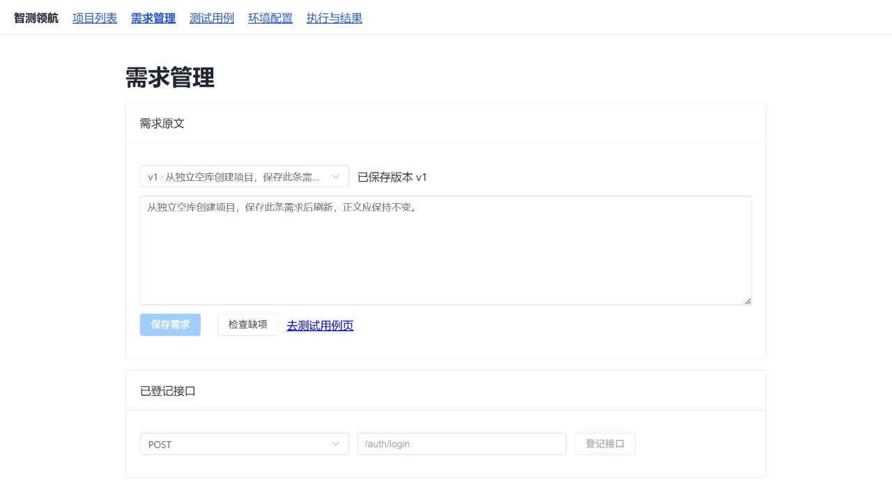

# 曾炜毅：第二阶段启动复现交付

## 范围与基线

依据第二阶段任务卡“让另一台 Windows 电脑从空库启动”。基线为main的`7ccc4e5`（PR #11已合入），分支为`feat/phase2-reproducible-start`。
保留第一阶段的个人分支，未改动页面、公共字段和业务模块。

入口：`scripts/start.ps1`；实际调度：`scripts/dev.py`；受控Python子服务：`scripts/service_host.py`。
配套有根README、`docs/windows-start.md`、9项启动诊断测试及`verify_startup.py`独立环境验收。

## 当前启动流程的复现结果

已在独立源码目录按原说明创建新虚拟环境，安装后端requirements、在frontend运行npm ci，并通过原有7项project-data真实HTTP检查。工具版本为Python 3.13.15、Node.js 24.18.0、npm 11.16.0。
基线后端回归为93 passed。原根README存在重复的前端章节，默认dev进入Mock，需要操作者手动对齐三项服务。
启动入口测试使用Windows PowerShell 5.1.26100.9818；代码测试提交为`18feb5990a29bf431136381de0619f2558b4a001`。

## 本次实现

- Windows PowerShell入口从任意工作目录定位仓库，调用现有后端配置和npm dev脚本。
- 启动前核对工具、依赖与三个端口；启动后核对演示服务、API健康与Vite的真实代理。
- 显式真实模式；模型配置沿用环境变量，`-NoModel`可跳过模型，人工确认、执行及报告照常。
- 仅安装仓库本地依赖，不改系统配置；不因端口占用结束原进程，不删除现有数据库。
- 正常停止清理本次服务及npm/Vite子进程；重启使用同一SQLite文件。
- 输出工具版本、模式、可访问地址和下一步，不输出密钥、密码或token。

## 验证与证据

```powershell
python -m unittest discover -s scripts/tests -v
python scripts/verify_startup.py --output docs/evidence/phase2-startup.json
```

9项诊断测试已通过，覆盖缺少Node/npm、低版本、被占端口保留、只读检查、缺依赖拒绝以及模型环境隔离。
独立环境验收分别记录：干净目录安装与三服务启动、真实Vite代理创建项目和需求、无模型人工确认与执行报告、服务停止后端口释放、重启后相同ID/文本/历史报告、缺Node修复提示、原端口占用进程和数据库不变。
结果为 **9项诊断测试通过、8项独立环境验收通过**。首次在无.venv和node_modules的新检出中实际安装，再用新SQLite创建项目及需求；另一次以SkipInstall重启并读取相同ID、正文和历史报告。
准确时间、版本及脱敏ID见[验收JSON](evidence/phase2-startup.json)。
真实浏览器另创建项目`f7480a46-ae8d-4c3b-9230-a89610cfe18c`及需求`88a64d9b-1416-472e-89ec-e832ef7f07c9`，保存后刷新，界面仍显示相同正文和已保存版本v1。



## 交接与待验证

给林彦羽、陈睿涛的启动命令为根README中的`start.ps1 -NoModel`，真实浏览器联调固定使用`VITE_USE_MOCK=false`，实际页面为`http://127.0.0.1:5173/projects`。
给郭泽强评审的PR包含入口、运行命令、测试输出、脱敏证据及本说明。其他同学继续使用原业务接口，无字段变更。

第二位同学/第二台电脑的实际复现：**待回传**。请实际操作者按[第二人复现表](windows-start.md)记录第一处问题；本机独立测试目录和新虚拟环境的验证不代替该记录。
本次未进行真实模型调用或模型效果评估。其他Python/Node版本及非Windows操作系统不作为已验证环境。

参考：[npm ci](https://docs.npmjs.com/cli/v10/commands/npm-ci/)、[Vite strictPort](https://vite.dev/config/server-options#server-strictport)、[Python子进程管理](https://docs.python.org/3.13/library/subprocess.html)。
